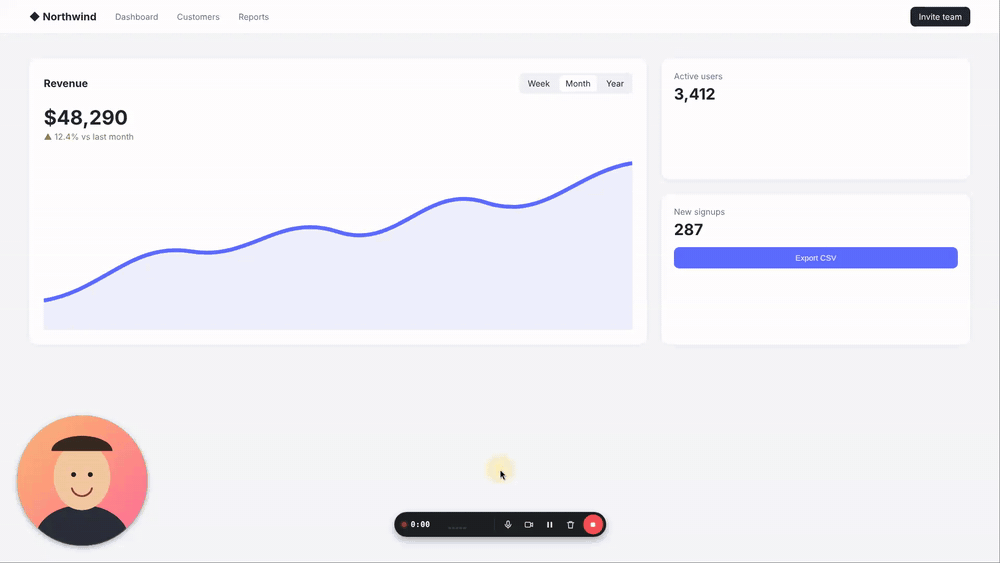

First public release of **Zri** — a free, open-source Loom-style screen recorder that keeps everything on your computer.

### Highlights
- Draggable, resizable camera bubble (circle / square / 16:9) that stays on top, even over full-screen apps
- A ring on every click, optional cursor spotlight
- Native resolution (Retina included), 30/60 fps, H.264 MP4 saved to your Desktop
- Mic noise suppression, optional computer sound (macOS 14.2+, Windows), anti-clipping limiter
- Floating controls (pause, mute, camera, delete) kept out of the recording
- Hotkeys: ⌥⇧R start/stop, ⌥⇧P pause, ⌥⇧M mute, ⌥⇧C camera
- Crash recovery: an interrupted recording is restored on the next launch
- English and Russian UI

### Downloads
| File | For |
|---|---|
| `Zri-1.0.0-mac-arm64.zip` | macOS on Apple Silicon (M1–M4) — tested on a MacBook Air |
| `Zri-1.0.0-mac-x64.zip` | macOS on Intel — beta, not yet tested on real hardware |
| `Zri-1.0.0-win-x64.zip` | Windows 10/11, portable — beta, not yet tested on real hardware |
| `Zri-1.0.0-linux-x86_64.AppImage` | Linux x64 (X11) — beta |

**macOS first launch:** the app isn't notarized yet. Unzip, move Zri to Applications, open it, then go to System Settings → Privacy & Security → **Open Anyway** (or run `xattr -dr com.apple.quarantine /Applications/Zri.app`). Then allow Camera, Microphone and Screen Recording.

Checksums are in `SHA256SUMS.txt`.
