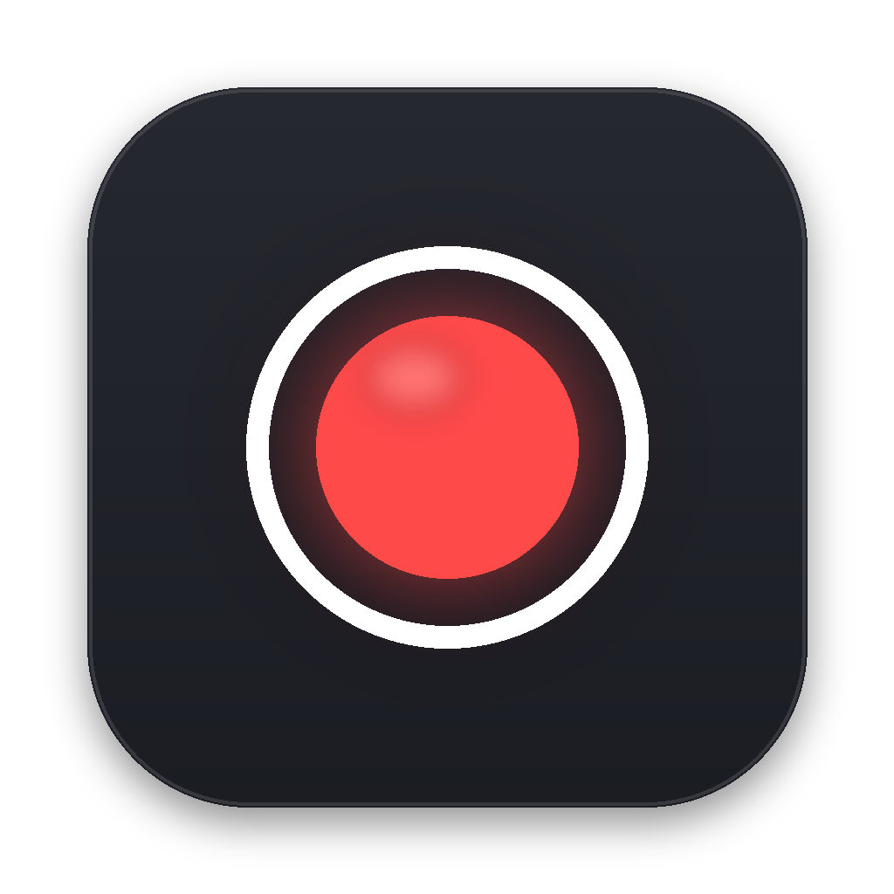
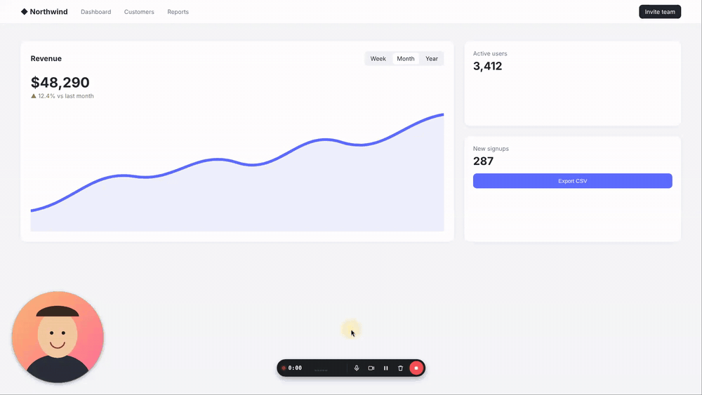

<div align="center">



# Zri

**A free, open-source screen recorder with a camera bubble and click highlights — like Loom, but local.**

No account, no cloud, no time limits. Your recording is saved as an MP4 on your Desktop.

[Download](#download) · [Русский](README.ru.md)



</div>

## Features

- **Camera bubble** — drag it anywhere, resize it with the scroll wheel or +/−, switch between circle, square and 16:9.
- **Click highlights** — a ring appears on every click (left clicks yellow by default, right clicks blue); optional cursor spotlight.
- **Clean sound** — mic noise suppression, optional computer sound (macOS 14.2+ and Windows), a limiter so nothing clips.
- **Good quality** — native screen resolution (Retina included), 30 or 60 fps, H.264 MP4 that plays everywhere.
- **Recording controls** — floating bar with timer, pause, mute, camera toggle, delete; hidden from the recording on macOS and Windows.
- **Hotkeys** — `⌥⇧R` start/stop, `⌥⇧P` pause, `⌥⇧M` mute, `⌥⇧C` camera (Alt+Shift on Windows/Linux).
- **Never lose a take** — the recording is streamed to disk while you record; if the app or the computer crashes, it is restored on the next launch.
- **Private** — no accounts, no cloud, no analytics. Recordings never leave your computer.
- English and Russian interface (follows your system language).

## Download

Get the latest build from [**Releases**](https://github.com/keydzi116/zri/releases/latest).

| System | File | Status |
|---|---|---|
| macOS, Apple Silicon (M1–M4) | `Zri-x.y.z-mac-arm64.zip` | ✅ main platform, tested on a MacBook Air |
| macOS, Intel | `Zri-x.y.z-mac-x64.zip` | 🧪 beta — built, not yet tested on real hardware |
| Windows 10/11 (x64) | `Zri-x.y.z-win-x64.zip` (portable) | 🧪 beta — built, not yet tested on real hardware |
| Linux x64 (X11) | `Zri-x.y.z-linux-x86_64.AppImage` | 🧪 beta — tested automatically on a virtual display |

### First launch on macOS

Zri is not notarized by Apple yet (that needs a paid developer account), so macOS blocks it the first time:

1. Unzip and drag **Zri** to **Applications**.
2. Open it. When macOS says it can't verify the app, go to **System Settings → Privacy & Security**, scroll down and click **Open Anyway**.
   Or run once in Terminal: `xattr -dr com.apple.quarantine /Applications/Zri.app`
3. Allow **Camera** and **Microphone** when asked.
4. Turn on Zri in **Privacy & Security → Screen & System Audio Recording**, then press **Restart** in Zri.

### Windows

Unzip anywhere and run `Zri.exe`. SmartScreen may warn about an unknown publisher → **More info → Run anyway**.

### Linux

`chmod +x Zri-*.AppImage && ./Zri-*.AppImage`. X11 sessions only for now (Wayland screen capture is not supported yet).

## Usage

1. Pick a screen (or a single window), a camera and a microphone.
2. Press **Start recording** (or `⌥⇧R`). A 3-2-1 countdown starts.
3. Stop from the floating bar or with `⌥⇧R`. The MP4 lands on your Desktop, and Zri shows a preview with buttons to open it or reveal it in Finder.

When you record a single window, the camera bubble and click rings are not included — they are drawn on top of the screen, so record a whole screen for those.

## How it works

Zri is an [Electron](https://www.electronjs.org/) app. The screen, camera bubble and click rings are composed by the OS — the bubble and rings are transparent always-on-top windows — and captured with Chromium's `MediaRecorder` (hardware H.264 where available). Chunks are written to disk every second, then [FFmpeg](https://ffmpeg.org/) remuxes them into a fast-start MP4 without re-encoding. Clicks are detected by reading the system mouse state through [koffi](https://koffi.dev/) (CoreGraphics on macOS, `GetAsyncKeyState` on Windows, X11 on Linux), so no Accessibility or Input Monitoring permission is needed.

## Build from source

```bash
git clone https://github.com/keydzi116/zri.git && cd zri
npm install
npm run vendor      # downloads ffmpeg + koffi binaries for all platforms
npm start           # run in development
npm run dist:mac    # or dist:win / dist:linux (dist:mac needs rcodesign for ad-hoc signing)
```

End-to-end tests are described in [test/README.md](test/README.md).

## Roadmap

- Signed and notarized macOS build, Windows installer
- Trim the start/end before saving
- Send the video straight to Telegram or copy a share link
- Auto-zoom on clicks

Ideas and bug reports are welcome in [Issues](https://github.com/keydzi116/zri/issues).

## Name

*Zri* (зри) is Old Church Slavonic for "behold, look" — as in the old saying "зри в корень", *look to the root of things*.

## License

[MIT](LICENSE). Release builds bundle FFmpeg (GPL v3) as a separate program — see [THIRD_PARTY_NOTICES.md](THIRD_PARTY_NOTICES.md).
