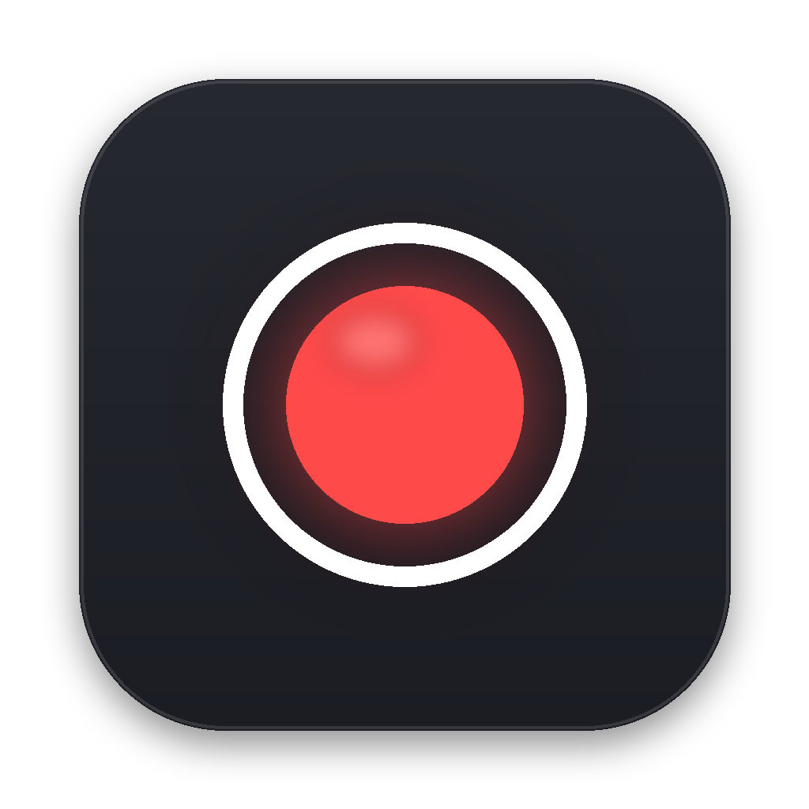
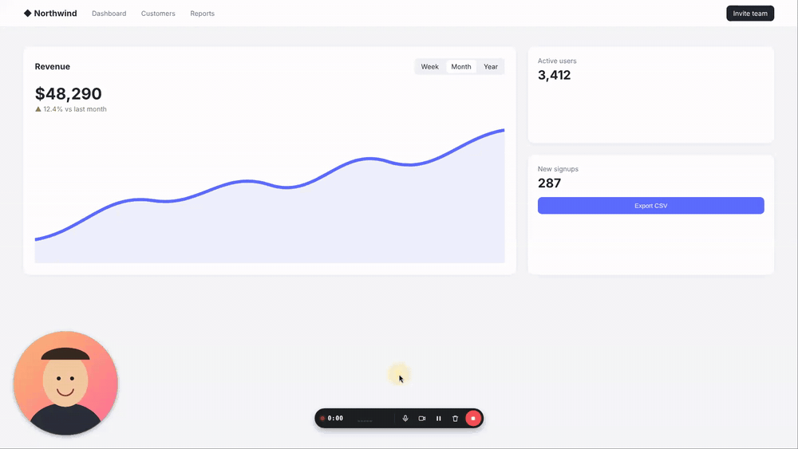

<div align="center">



# Zri

**Бесплатная программа с открытым кодом для записи экрана: кружок камеры и подсветка кликов, как в Loom, только всё у вас на компьютере.**

Без аккаунта, без облака, без ограничений по времени. Готовое видео сохраняется в MP4 на Рабочий стол.

[Скачать](#скачать) · [English](README.md)



</div>

## Что умеет

- **Кружок камеры** — двигается мышкой куда угодно, размер меняется колёсиком или кнопками «−» и «+», формы: круг, квадрат, 16:9.
- **Подсветка кликов** — кольцо на каждом клике (левый — жёлтый, правый — синий), по желанию подсветка курсора.
- **Чистый звук** — шумоподавление микрофона, звук компьютера (macOS 14.2+ и Windows), лимитер, чтобы ничего не хрипело.
- **Хорошее качество** — родное разрешение экрана (включая Retina), 30 или 60 кадров в секунду, MP4 (H.264), который открывается везде.
- **Панель записи** — таймер, пауза, микрофон, камера, удаление; на macOS и Windows сама панель в видео не попадает.
- **Горячие клавиши** — `⌥⇧R` старт/стоп, `⌥⇧P` пауза, `⌥⇧M` микрофон, `⌥⇧C` камера (на Windows/Linux — Alt+Shift).
- **Запись не пропадёт** — видео пишется на диск прямо во время записи; если программа или компьютер упадут, при следующем запуске оно восстановится.
- **Приватно** — ни аккаунтов, ни облака, ни аналитики. Записи никуда не уходят с вашего компьютера.
- Интерфейс на русском и английском (по языку системы).

## Скачать

Последняя версия — в разделе [**Releases**](https://github.com/keydzi116/zri/releases/latest).

| Система | Файл | Статус |
|---|---|---|
| macOS, Apple Silicon (M1–M4) | `Zri-x.y.z-mac-arm64.zip` | ✅ основная платформа, проверена на MacBook Air |
| macOS, Intel | `Zri-x.y.z-mac-x64.zip` | 🧪 бета — собрана, на реальном Mac ещё не проверялась |
| Windows 10/11 (x64) | `Zri-x.y.z-win-x64.zip` (без установки) | 🧪 бета — собрана, на реальном компьютере ещё не проверялась |
| Linux x64 (X11) | `Zri-x.y.z-linux-x86_64.AppImage` | 🧪 бета — проверена автотестами на виртуальном экране |

### Первый запуск на macOS

Программа пока не заверена Apple (для этого нужен платный аккаунт разработчика), поэтому при первом запуске macOS её блокирует:

1. Распакуйте архив и перетащите **Zri** в **Программы**.
2. Откройте её. Когда macOS скажет, что не может проверить программу, зайдите в **Системные настройки → Конфиденциальность и безопасность**, прокрутите вниз и нажмите **«Всё равно открыть»**.
   Или один раз выполните в Терминале: `xattr -dr com.apple.quarantine /Applications/Zri.app`
3. Разрешите доступ к **камере** и **микрофону**.
4. Включите Zri в **«Конфиденциальность и безопасность → Запись экрана и системного аудио»** и нажмите в Zri **«Перезапустить»**.

### Windows

Распакуйте в любую папку и запустите `Zri.exe`. SmartScreen может предупредить о неизвестном издателе → **«Подробнее» → «Выполнить в любом случае»**.

### Linux

`chmod +x Zri-*.AppImage && ./Zri-*.AppImage`. Пока только сессии X11 (запись экрана под Wayland не поддерживается).

## Как пользоваться

1. Выберите экран (или одно окно), камеру и микрофон.
2. Нажмите **«Начать запись»** (или `⌥⇧R`) — будет отсчёт 3-2-1.
3. Остановите запись кнопкой на панели или `⌥⇧R`. MP4 появится на Рабочем столе.

Если записывать одно окно, кружок камеры и кольца кликов в видео не попадут — они рисуются поверх экрана, поэтому для них записывайте весь экран.

## Собрать из исходников

```bash
git clone https://github.com/keydzi116/zri.git && cd zri
npm install
npm run vendor      # скачает ffmpeg и koffi для всех платформ
npm start           # запуск в режиме разработки
npm run dist:mac    # или dist:win / dist:linux
```

Автотесты описаны в [test/README.md](test/README.md).

## Название

*Зри* — по-старославянски «смотри, взирай», как в «зри в корень».

## Лицензия

[MIT](LICENSE). В сборки входит FFmpeg (GPL v3) как отдельная программа — подробнее в [THIRD_PARTY_NOTICES.md](THIRD_PARTY_NOTICES.md).
